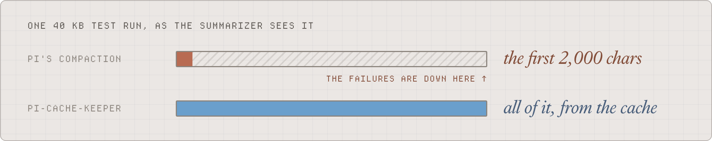

# pi-cache-keeper

A Pi extension that makes the prompt cache pay off. It compacts by reading the prompt cache your session already built, so on big sessions it costs a fraction of Pi's compaction, and the summary is written from the full tool output instead of 2,000-character excerpts. It compacts when the context gets full or just before the cache expires, and it can keep the cache warm through a break. It also fills in what Pi doesn't know about a model (how much input it takes, how long its cache lasts, what it costs) from [providers.dev](https://providers.dev).

pi-cache-keeper is based on [pi-cached-compaction](https://github.com/nicobailon/pi-cached-compaction) by Nico Bailon, released under the MIT licence. Compaction from the warm cache, the compaction card, the cache countdown, compacting before the cache expires and the longer cache are his work, and his commits are kept in this repository's history. Added here since then: compacting when the context is full (`compactAtPercent`) or at a token cap (`compactAtTokens`), a summary sized to the model's window, a settings menu, a cache countdown that says what it means for cost, keeping the cache warm while Pi is idle (`keepWarmMinutes`, off unless you set it), and each model's input window, cache lifetimes and prices from [providers.dev](https://providers.dev). This is a separate project; it is not maintained by Nico Bailon.

Nico Bailon's 78-second explainer of the original extension (it uses the old name):

https://github.com/user-attachments/assets/04cec926-4eaa-411b-ad1c-33aba6109323


A real card from a 667k-token Opus 5.5 session, measured for the original extension: a subagent implementing a GitHub issue over 393 responses, replayed through pi-claude-bridge. Claude Code bills by subscription, so the bridge's own card compares tokens; the dollars here are the same token counts at Anthropic's API prices for Opus 5.5. Two things the card doesn't show:

- **The summary saw all the tool output.** Pi's compaction would have cut 109 of the session's 521 tool results to 2,000 characters, which drops 61% of the tool output before the model reads it. That output was already in the cache, so reading all of it is part of the $0.19.
- **The footer counts down to the expensive part.** At this size, letting the cache expire means your next message rewrites all 667k tokens, $5.33 at the 1-hour rate. If Pi is idle, the extension compacts 20 seconds before that.

## Why this exists

Pi's compaction swaps the system prompt, drops the tools, and flattens the messages into text. None of that matches what the provider has cached, so every token of the summary request is billed at full price.

It also cuts every tool result down to its first 2,000 characters, and the bigger the session, the more that throws away. Long sessions do their work in long outputs: whole files, test runs, build logs. The summarizer sees only the start of each one, so it misses the bottom of the file and the failures listed at the end of the test run. In eleven sessions that passed 700k tokens, measured for the original extension, Pi's compaction would have shown it 35–57% of the tool output, leaving out 300k to 1M characters per session.



This extension keeps the system prompt, the tools, and the messages as they are, and appends one instruction instead, as the next turn of the same conversation:


The provider reads nearly all of it from the cache at about a tenth of the input price, and the model writing the summary sees the whole conversation, tool output included. The result looks like Pi's: its checkpoint format, its window of recent messages kept as they are, and the read and modified file lists carried forward.

## vs Pi's compaction

| | Pi's compaction | pi-cache-keeper |
|---|---|---|
| What it sends | the older messages as text, under its own system prompt | your conversation as it is, plus one instruction |
| Prompt cache | not used | about 99% read from it at normal compaction sizes |
| Tool output the summary sees | the first 2,000 characters of each result | all of it, read from the cache |
| Cost | full price, for the older messages only | 0.1× for the whole session: less once there's a lot to summarize, more on small sessions ([numbers](#what-it-costs)) |
| After a long break | your next message rewrites the whole expired cache | it compacts just before the cache expires, so there's much less to rewrite |
| Cache lifetime | Pi's default (5 minutes on Anthropic) | 1 hour in interactive sessions, which Anthropic bills at 2× per write instead of 1.25× ([why](#compacting-before-the-cache-expires)) |
| What you see | the summary | the summary, a card comparing the cost with Pi's compaction, and a cache countdown in the footer |

Before sending, the extension checks that the request repeats your last one byte for byte up to the new part. When it can't prove that, Pi's own compaction runs as usual. (Claude through pi-claude-bridge is checked by the bridge instead; see [Providers](#providers).)

## Install

```bash
pi install git:github.com/ngvoicu/pi-cache-keeper
```

Then run `/reload` (Pi loads extensions only at startup or on `/reload`). It needs Pi 0.87.0 or newer. Compacting from the cache, compacting when full, compacting before expiry and [model data from providers.dev](#model-data-from-providersdev) are on by default; keeping the cache warm is off until you set `keepWarmMinutes`.

### Moving from pi-cached-compaction

- Remove pi-cached-compaction first: `pi list` shows the address you installed it from, and `pi remove <that address>` removes it. With both loaded, both would compact and both would show a countdown.
- Your settings carry over: while `~/.pi/agent/settings.json` has no `cacheKeeper` key, pi-cache-keeper reads the old `cachedCompaction` key as it is. The settings menu saves to `cacheKeeper` (starting from what it read) and leaves `cachedCompaction` alone; from then on `cacheKeeper` is the one that counts.
- The commands are `/cache-keeper` and `/cache-keeper-settings` instead of `/cached-compaction` and `/cached-compaction-settings`.
- The log is `~/.pi/agent/cache-keeper.jsonl`; the old `cached-compaction.jsonl` is left where it is and not read. Cards from earlier compactions still show in old sessions.

## What you'll see

**The card** at the top appears under the summary after each compaction. It's shown to you only, never sent to the model, and stays in the session after a resume. Its second line compares this compaction with what Pi's would have cost for the same messages: green when this one cost at least 5% less, amber when it cost at least 5% more, and "about the same" in between. Models with no price, like Claude Code's subscription models through pi-claude-bridge, get the comparison in tokens not read from the cache instead of dollars.

**Pi's side is an estimate,** since Pi's compaction never runs. The extension serializes the messages exactly as Pi's compaction would, then counts tokens at the rate the provider counted for this summary request, so it follows each model's tokenizer. In the original author's tests it came within 2–12% of what Pi's compaction actually sent, always a little high, so the card slightly overstates the saving.

**When the cache can't be used,** the card says why and what Pi's compaction did instead. Expand it with ctrl+o to see what the decision rested on:


**The countdown** in the footer shows how long the cache has left. Sending a message restarts it, and it reads `cache warm · 59m left … cache warm · 0:25 left` (in the warning color for the last 30 seconds), then `cache cold · next message full price`. A message sent while the cache is warm reads the conversation from the cache at a fraction of the price and restarts the countdown; after it goes cold, the next message pays full price to write the conversation again. While a request runs it reads `cache in use`, so the status keeps its place in the footer. In powerline-footer it shows in the `extension_statuses` segment. The lifetime is the model's declared one, else the cache tier the provider reports writing (Anthropic and pi-claude-bridge report it), else OpenAI's 30-minute minimum for GPT-5.6 and later, else Kimi K3's 5-minute or 1-hour option. Models with none of those show no countdown.

**`/cache-keeper`** shows the cache right now, whether the next compaction would take the cached path, the model data in use, and this session's log:

![The output of /cache-keeper: "pi-cache-keeper · opencode-go/gpt-6-luna. cache: ⏱ 29m left (lifetime 30 min, OpenAI's minimum). next compaction: cached path; last request 4 s ago with 186 messages, 1 since. The request prefix is checked when it runs. before expiry: on, from 50k tokens of context · retention long. log: ~/.pi/agent/cache-keeper.jsonl. This session: 23:43:49 /compact: cached, 99% of 50k from cache, 2k out, 11.3s, summary 3263 chars. vs Pi's compaction: 62% less, $0.0013 instead of ~$0.0035 (it sends ~27k tokens, none from cache). 23:43:49 saved, 49k tokens summarized."](media/status-command.png)

**The log.** Every decision is also appended to `~/.pi/agent/cache-keeper.jsonl`, which moves to `.1` past 5 MB. Each line records what triggered the compaction, the path it took and why, the request settings, the provider's cache usage, the estimate for Pi's compaction, and the timing. When the request didn't match, it includes up to 200 characters of each version around the first difference. The log stays on your machine.

```sh
jq -c 'select(.event == "compact") | {at, trigger, outcome, reason, cacheRead: .response.usage.cacheRead, piEstimate}' ~/.pi/agent/cache-keeper.jsonl
```

## Common tasks

| Want | Do |
|---|---|
| See the cache now and this session's compactions | `/cache-keeper` |
| See why a compaction didn't use the cache | expand its card with ctrl+o |
| Change the settings from Pi | `/cache-keeper-settings` |
| Compact earlier or later on big models | change "Compact when the context is" (`compactAtPercent`) |
| Keep the context under a fixed size on every model | set "Or once it holds" (`compactAtTokens`) |
| Stop compacting before the cache expires | `"compactBeforeExpiry": false` in [Settings](#settings) |
| Compact before expiry only on bigger sessions | raise `minContextTokens` |
| Keep the cache warm through a long break | "Keep the cache warm when idle" (`keepWarmMinutes`), see [Keeping the cache warm](#keeping-the-cache-warm) |
| Keep Pi's 5-minute cache and its 1.25× writes on Anthropic | `"cacheRetention": "short"` |
| See what is known about the current model | the footer: `· window ✓ · cache short ✓ · long ✗ · price ✓` (see [Model data](#model-data-from-providersdev)) |
| Fetch the model data again now | `/cache-keeper-refresh` |
| Get the countdown on a model providers.dev has no lifetime for | declare one with Pi's `modelOverrides.promptCache` |
| Look through past decisions | the `jq` line under [What you'll see](#what-youll-see) |

## Commands

| Command | What it does |
|---|---|
| `/cache-keeper` | shows the cache right now, whether the next compaction would read it, the settings in effect, the model data in use, and this session's log |
| `/cache-keeper-settings` | opens the settings menu; outside the TUI it lists the settings |
| `/cache-keeper-refresh` | fetches the model data from providers.dev now and puts it into Pi's `models.json` (see [Model data](#model-data-from-providersdev)) |
| `/compact` | Pi's own command; it goes through the cached path too |

## Settings

Run `/cache-keeper-settings` to change them in a menu; changes are saved to the `cacheKeeper` key in `~/.pi/agent/settings.json` and apply right away. You can also edit that key by hand. When there is no `cacheKeeper` key, the `cachedCompaction` key of pi-cached-compaction is read instead, unchanged. Project settings files don't apply to it, and an unknown key is an error.

| Setting | Default | What it does |
|---|---|---|
| `compactAtPercent` | `90` | after a turn, compact once the context fills this share of the model's window; `0` turns it off |
| `compactAtTokens` | `0` | also compact once the context holds this many tokens, on any model, whichever comes first; `0` turns it off |
| `compactBeforeExpiry` | `true` | compact 20 s before the cache expires, when idle |
| `minContextTokens` | `140000` | the smallest context worth keeping warm or compacting before expiry |
| `keepWarmMinutes` | `0` | keep the cache warm for this many minutes after Pi goes idle; `0` turns it off |
| `cacheRetention` | `"long"` | ask for the longer cache in interactive sessions (2× writes on Anthropic and Kimi); `"short"` keeps Pi's default |
| `modelData` | `true` | read each model's input window, cache lifetimes and prices from providers.dev and put them into Pi's `models.json`; `false` takes them out again |

```json
{
  "cacheKeeper": {
    "compactBeforeExpiry": false
  }
}
```

## Compacting when the context is full

A summary needs room in the context window next to the conversation it summarizes. Pi's own automatic compaction starts when only `compaction.reserveTokens` (16k by default) is left, which on a 1M-token model leaves too little room for the summary of a 980k-token conversation, so the cached request runs out of room and Pi's compaction runs instead, at full price.

So after a turn, once the context fills `compactAtPercent` of the model's window (90% by default: 900k of 1M, leaving about 96k for the summary), the extension compacts right away, while the cache that turn just wrote is warm. It only does this when Pi is idle with nothing queued and Pi's auto-compaction is on. If the cached path isn't available, Pi's compaction runs, which is still cheaper now than at the very end. A run of tool calls that fills the window within one turn still ends in Pi's own compaction.

**A token cap.** A percentage means a different size on every model: 70% is 700k tokens on a 1M-token model and 190k on a 272k one. `compactAtTokens` sets one size for all of them, and the session compacts at the cap or the percentage, whichever comes first. The reason to set it is cost rather than room: every request reads the whole context from the cache, so a 690k-token context costs about $0.14 per request at $0.20 per million cached tokens, before the model writes anything. A lower cap makes each request cheaper, and older detail is summarized sooner.

The summary request may use the model's output limit, reduced so the conversation and the summary fit the window, as Pi's own compaction does. When less than 16k tokens would be left, the extension doesn't try the cached path and Pi's compaction runs.

## Compacting before the cache expires

If you step away, the cache expires and your next message pays to write the whole session again. So 20 seconds before expiry, the extension compacts from the still-warm cache, and your next message rewrites a summary-sized context instead. It only does this when:

- Pi is idle with nothing queued,
- Pi's auto-compaction is on,
- the context holds at least 140k tokens (`minContextTokens`),
- and the cached path is available.

Otherwise it does nothing and the cache cools. Models without a [countdown](#what-youll-see) never compact before expiry.

The threshold is in tokens rather than percent because rewriting an expired cache costs in proportion to its size, and on 1M-token models a percentage would almost never trigger.

**The longer cache.** A 5-minute cache expires during most breaks, so in interactive sessions the extension asks for the longer one (`PI_CACHE_RETENTION=long`) unless you've set that variable yourself. That's 1 hour instead of 5 minutes on Anthropic and Kimi K3, and a 12-hour shared system prompt on GPT-5.6 and later (see [Providers](#providers)). It isn't free: writing a 1-hour cache costs 2× the input price, instead of 1.25× on Anthropic and 1× on Kimi, though reads cost the same. Headless runs (`pi -p`, JSON mode, subagent processes) keep the short cache, since nobody pauses there. The choice is made once per session, because moving a cache up a tier means writing all of it again.

## Keeping the cache warm

Pi can keep an idle cache warm itself (`cacheWarming: "idle"`), but only until 30 minutes after the last request started, and only when it expects the refresh to pay for itself. Its refresh comes at 90% of the lifetime, so a 1-hour cache (54 minutes) is never refreshed while idle. Set `keepWarmMinutes` to choose how long after Pi goes idle the cache should stay warm, for example `120` for two hours.

3 minutes before a 1-hour cache expires (25 seconds before a 5-minute one, after Pi's own refresh would have run), the extension re-sends the last request exactly as it was sent with a one-token answer, the way Pi's warming does. The provider reads the cache entry and its lifetime starts again. It does this while the cache would otherwise expire inside the window, so a 1-hour cache in a 2-hour window is refreshed about twice. When the window ends, the cache is left to expire, and [compacting before expiry](#compacting-before-the-cache-expires) takes over as before. It only refreshes when:

- Pi is idle with nothing queued,
- the context holds at least `minContextTokens`,
- the cached path is available (the same check as compacting from the cache),
- and the request doesn't use Claude's budget-based thinking, which keys the cache on the output limit. Adaptive thinking is fine.

Each refresh reads the whole context from the cache: about a tenth of the input price on Anthropic. In one measured session, a refresh of a 692k-token Claude context cost $0.14, against about $6.90 to write it again at that model's cache-write price. On a subscription it is free but counts toward your usage. If a refresh fails, or reads less than 90% from the cache (the route behind a proxy may not cache), refreshing stops until your next message, and Pi shows a warning. A new message cancels a refresh in flight. Refreshes are listed in `/cache-keeper` and the log, and the footer shows `cache warm · refreshing` while one runs.

Pi's footer totals don't include these refreshes, since an extension can't add usage to the session; the log has their cost. After a restart, the countdown doesn't know about refreshes sent before it, so it may show the cache as cold early.

## Model data from providers.dev

Pi's model catalog doesn't say how long most providers keep a prompt cache, and for some models its input window is smaller than what the provider accepts. Without a lifetime there is no countdown, no compacting before expiry and no warming; with a window that is too small, Pi compacts long before it has to.

[providers.dev](https://providers.dev) publishes both, with prices, for each model at each provider and access method (API key or subscription login), from the providers' documentation and from evaluations. The extension reads that and puts it into the `modelOverrides` of `~/.pi/agent/models.json`, the place Pi has for it. Pi's own warming and compaction then use the same numbers as the countdown here.

| Value | What is written |
|---|---|
| Input window (`contextWindow`) | providers.dev's window replaces Pi's. A window that is only "the largest input an evaluation saw accepted" can raise Pi's and never lowers it |
| Cache lifetimes (`promptCache.short`, `promptCache.long`) | only for a tier Pi has no lifetime for. "No safe lifetime" is never declared |
| Prices (`cost`, with a tier per context size) and output limit (`maxTokens`) | only where Pi has none |

**The footer** shows what was found for the current model: `· window ✓ · cache short ✓ · long ✗ · price ✓`. `✓` is found, `✗` is not in the data, `?` is found but not used because it depends on how the model is reached (below). `/cache-keeper` names the entry and the values.

**What you should know before it changes how Pi behaves:**

- A model that gets a cache lifetime also gets what comes with one: Pi's own warming (`cacheWarming` in Pi's settings) and this extension's countdown and compacting before expiry. A model with a 5-minute lifetime and a context over `minContextTokens` is compacted after about 5 idle minutes, unless Pi's warming or `keepWarmMinutes` keeps it warm.
- A larger window means larger, more expensive requests before anything compacts. `compactAtTokens` caps that on every model.
- Values you set in `models.json` yourself are never touched. The extension keeps a note of what it wrote (in `~/.pi/agent/cache-keeper-models.json`) and only updates or removes those values. If `models.json` has comments, it is left alone.

**How a model is looked up.** A provider you signed in to with a subscription is looked up as that subscription (the Claude and Meta logins have entries of their own); with an API key, as the API. Pi's ChatGPT sign-in on the `openai` provider has no entry of its own, so it is treated like the last case below.

**Through [CLIProxyAPI](https://github.com/router-for-me/CLIProxyAPI)** (the `cliproxyapi` provider): `devin/…` is Devin, `lab/model` is OpenRouter. A plain model name can be served by the lab's subscription login or by its API key, and the proxy's model list doesn't say which. The two can differ (a Claude login keeps a cache for an hour, a Claude API key for 5 minutes by default), and a wrong guess would either refresh a 1-hour cache every 5 minutes or let a 5-minute cache expire. So only what both entries agree on is used, the window is the smaller of the two, and the rest shows as `?`. The proxy's model list is read from the proxy itself, with the key Pi already uses for it.

**When it fetches.** At the start of an interactive session, when the saved data is a day old or Pi can use a provider there is no data for. One small request asks whether the dataset changed; only then are the providers you can use downloaded (a few dozen kilobytes). A failed fetch keeps the saved data. Nothing is fetched on its own in print or JSON mode or with `PI_OFFLINE` set. `/cache-keeper-refresh` fetches now.

**What is sent.** The names of the providers Pi has credentials for, as query parameters to a public read-only API. No key, no account, nothing about your sessions or prompts.

**Turning it off.** Set "Model data from providers.dev" to off in `/cache-keeper-settings` (`"modelData": false`). The values the extension wrote are taken out of `models.json`, which brings Pi's own back.

## Providers

| Provider | Cached compaction | Countdown and compact before expiry | Longer cache (interactive) |
|---|---|---|---|
| Claude via pi-claude-bridge | yes, on a copy of the Claude Code conversation | yes, 1 hour | Claude Code decides |
| Anthropic API | yes | yes, 1 hour | 1 hour instead of 5 minutes |
| Claude on opencode-go | yes | yes, 1 hour | 1 hour instead of 5 minutes |
| GPT-5.6+ on `openai` | yes, not tested live yet | yes, 30 minutes | 12-hour shared system prompt |
| GPT-5.6+ on opencode-go | yes | after you set the flag in `models.json` (below) | after the flag |
| Kimi K3 on `moonshotai` and `moonshotai-cn` | yes, not tested live yet | yes, 5 minutes or 1 hour | 1 hour instead of 5 minutes |
| Other Responses and Chat Completions APIs | yes | with a lifetime from providers.dev, or one you declare (`modelOverrides.promptCache`) | the provider's own |
| `openai-codex` (ChatGPT sign-in) | yes, not tested live yet | with the lifetime providers.dev has for the model; there's no documented one | no |
| Google and others | no, Pi's compaction runs | no | no |

**Claude through pi-claude-bridge.** These models run in Claude Code, so there's no HTTP payload for the extension to compare. Instead it sends the summary request with the bridge's `x-claude-bridge-fork: 1` header. The bridge runs it on a temporary copy of the live Claude Code conversation, which reads its cache, and then deletes the copy. The live conversation is only read. A bridge without fork support runs the request as a one-shot: the summary still works without the cache hit, and the card shows that. Claude Code keeps any tool result over about 50 KB as a file with a 2 KB preview, so for those the summary sees the preview, the same as the live model did.

Claude Code bills by subscription, so the bridge prices these models at $0. Here, compacting before expiry saves subscription quota and the slow first reply after a cold cache, not money. It also replaces the older part of the conversation with a summary well before Pi would compact a 1M-token model. If you'd rather keep the full context through long breaks, raise `minContextTokens` or turn it off. Claude Code also picks its own cache lifetime (1 hour on a subscription), so `cacheRetention` doesn't apply.

**GPT-5.6 and later.** With the longer cache, the system prompt and tools get a 12-hour cache under one key per project, so later sessions in the same project read them instead of writing them again. The conversation keeps OpenAI's 30-minute cache, and that's what the countdown follows.

| | Pi alone | With the extension |
|---|---|---|
| System prompt and tools | each session writes them at 1.25×, and they last 30 minutes | written once at 2.5× and kept 12 hours; later sessions in the project read them at 0.1× |
| Conversation | 30 minutes | 30 minutes (the countdown follows this) |

The 12-hour write costs an extra 1.25× of that prefix once, and the second session in the project that day earns it back. With a full set of extensions the prefix is around 19k tokens. Pi prices every cache write at the 30-minute rate, so its cost display understates the 12-hour part.

**Kimi K3 on Moonshot's API.** Kimi picks a cache lifetime of 5 minutes or 1 hour per request, and keeps a cache at the lifetime it was first written with. Pi doesn't send that option, so with the longer cache the extension adds it, and the countdown follows the lifetime it asked for. Pi's model catalog prices Kimi's cache writes at $0, so its cost display and the card leave them out. Kimi through opencode-go, OpenRouter, or Kimi For Coding keeps the host's own caching.

**opencode-go.** Pi doesn't send OpenAI's cache options to opencode-go's GPT models, so they get no 12-hour prefix and no countdown until you turn the options on. Add the flag to `~/.pi/agent/models.json` for each opencode-go GPT model that has it on `openai`, then pick the model again with `/model`:

```json
{
  "providers": {
    "opencode-go": {
      "modelOverrides": {
        "gpt-6-luna": { "compat": { "supportsExplicitPromptCacheMode": true } },
        "gpt-5.6-luna": { "compat": { "supportsExplicitPromptCacheMode": true } }
      }
    }
  }
}
```

Pi's own cache warmer only runs for models with a declared lifetime. If you want it to keep caches warm during long runs, add `"promptCache": { "short": 1800, "long": 1800 }` next to `compat`.

## What it costs

Pi's compaction keeps the last 20k tokens as they are and sends only what's older, as text with each tool result cut to 2,000 characters, at full price. This extension sends the whole session and pays the cache-read price (0.1×) for nearly all of it. So on small sessions, and on sessions that mostly read big files, Pi's is often cheaper: it has little to send. Once the older part is most of the session, which is usually the case when auto-compaction fires, reading everything at 0.1× costs less. The card shows both numbers every time, so you can see which case you're in.

The part that isn't cached is the instruction (about 400–600 tokens, depending on the model) plus anything added since the last request. That stays about the same size, so the cached share grows with the session: in the original author's tests 83% on a 2k-token session, 95% at 10k and 99% at 44k. For auto-compaction on a 200k model it works out to 99.7%. Auto-compaction can also fire in the middle of a run. Then the latest tool results are new too, but at that size they're still a small share.

Measured for the original extension, at the prices in Pi's model catalog. The Opus row is the session at the top, priced at Anthropic's API rates, and its Pi column is the card's estimate. The rest are GPT through opencode-go, where Pi's compaction was run too:

| Session at compaction | Pi's compaction | pi-cache-keeper |
|---|---|---|
| 667k tokens, a real coding session (`claude-opus-5-5`) | ~328k sent, ~$1.40 | 667k sent, 99% cached, $0.19 |
| 50k tokens, many small reads of source files (`gpt-6-luna`) | 26k sent, $0.0032 | 50k sent, 99% cached, $0.0013 |
| 44k tokens, ten whole docs read (`gpt-6-luna`) | 5.9k sent, $0.00090 | 44k sent, 99% cached, $0.00097 |
| 10k tokens, mostly long answers (`gpt-5.6-luna`) | 6.0k sent, $0.00224 | 10k sent, 95% cached, $0.00123 |
| 9k tokens, mostly long answers (`gpt-6-luna`) | 4.9k sent, $0.00087 | 8.8k sent, 94% cached, $0.00050 |
| 2k tokens, a few tool calls (`gpt-6-luna`) | 0.3k sent, $0.00009 | 2.2k sent, 83% cached, $0.00035 |

Where the two cost about the same, the difference is in what the summary was written from: the full tool output instead of 2,000-character excerpts.

## How it works

`/compact`, Pi's automatic compaction, and compacting before expiry all go through the same checks. The cached path is taken only when all four hold:

1. Same model as the last request, and the conversation only grew since then. New messages and extension notices are fine. Edits, `/tree`, a model switch, or a context overflow are not.
2. The last request used the cache, and the cache hasn't expired.
3. The instruction can quote where the kept messages start (below).
4. The rebuilt request is identical to the last one up to the new part. This runs on the exact request Pi would send, using Pi's own serializer, so a different thinking level (on most models), an edited message, or a field another extension changed all count. Nothing is sent when it fails.

If any check fails, Pi's own compaction runs. When compacting before expiry, nothing runs and the cache cools.

**Where the summary stops.** Pi keeps about the last 20k tokens of messages (its `keepRecentTokens` setting) word for word after the summary. The extension uses Pi's own cut point, so the summary has to stop where those messages begin. But the model reads the kept messages too, since they're part of the cached conversation:


So the instruction quotes the first kept message as the model sees it (and says which repeat it is, if that text appears more than once), says how many messages are kept, and tells the model to write the summary as if the conversation ended before the quoted one. In repeated tests where Pi's cut fell in the middle of a turn, no summary reported kept work as done. If the first kept message has nothing to quote (only an image, or only thinking), it doesn't guess: Pi's own compaction runs.

**Tools during the summary.** On the `openai` provider, the summary request sets `tool_choice: "none"`, which OpenAI keeps out of the cached prefix. Elsewhere changing it costs cache (on Anthropic it drops the message cache), so the model sees your tools and is told not to call them. If it calls one anyway, Pi's own compaction runs. In the tests no model tried.

## Limitations

- Without a known cache lifetime, the extension can't tell a cold cache from a warm one. A compaction after a long break then pays to rewrite the whole session. providers.dev fills in a lifetime where it has one ([Model data](#model-data-from-providersdev)); for other models, declare one with Pi's `modelOverrides.promptCache`.
- Through pi-claude-bridge the extension can't check the request. If the bridge can't copy the whole Claude Code conversation, the summary is still correct but reads less from the cache, and the card shows the low cache share.
- Fields that extensions loaded before this one add to provider requests are copied into the summary request, such as codex-fast's `service_tier`. Changes from extensions loaded after it aren't seen, so the request can miss the cache. The summary is still correct, it just costs about what Pi's compaction would, and the card shows the low cache share.
- When a later compaction falls back to Pi's own, its read and modified file lists start over. Pi doesn't carry the lists forward from an extension's compaction.
- Right after a compaction, the card is the session's last entry. A second `/compact` then says "Nothing to compact (session too small)" instead of "Already compacted". Both mean there's nothing new to compact.

## Documentation

[docs/live-tests.md](docs/live-tests.md) has every test run behind the numbers here: the cache share on each model, how close the card's estimate of Pi's compaction came, where the summary stops when Pi's cut falls mid-turn, Claude and GPT through opencode-go, and cache tiers through Claude Code.
